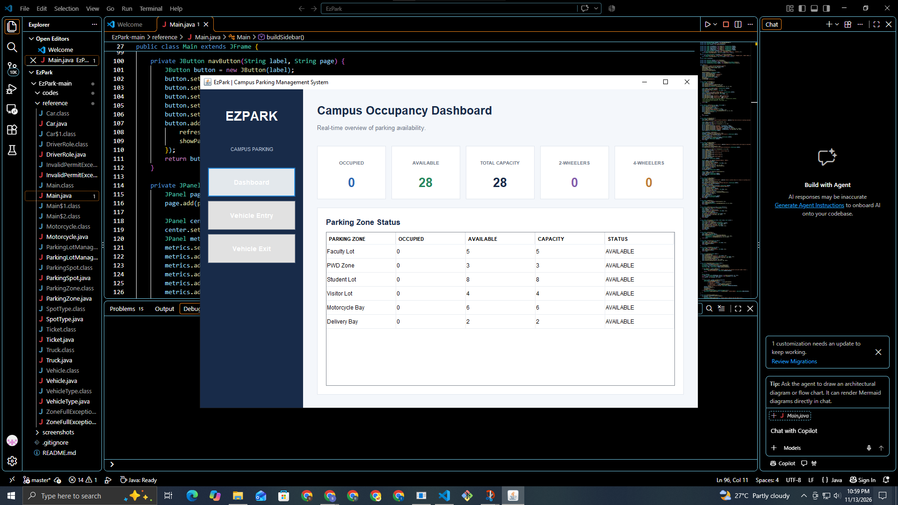
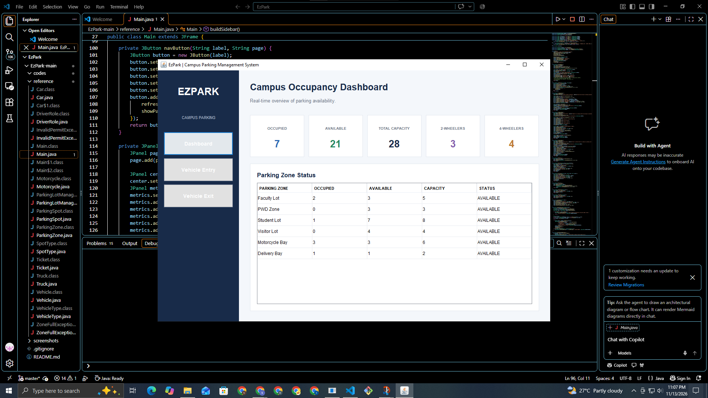
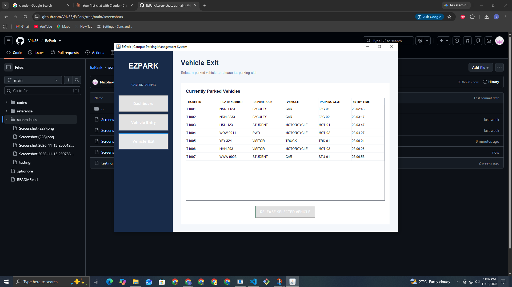
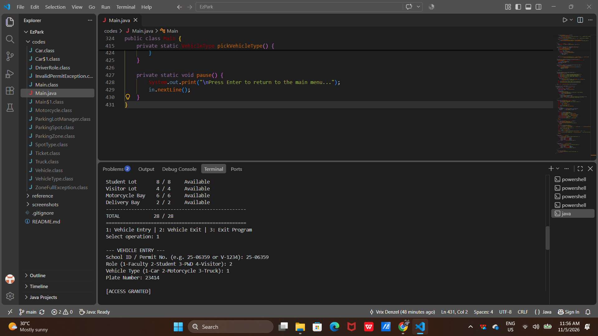

<p align="center">
  
</p>

<p align="center"><em>Add your tagline here.</em></p>


---

## **EzPark Overview**

EzPark is a Java campus parking management system that assigns parking spots to incoming vehicles based on who is driving and what they are driving. It has a Swing desktop interface with a live occupancy dashboard, and a console version of the same logic.

```
       ______
      /|_||_\`.__
     (   _    _ _\
     =`-(_)--(_)-'
```

When a vehicle enters, EzPark:

1. **Validates the permit.** Students and faculty **must** use a school ID in the format `25-12345`, and visitors must use a permit like `V-1234`. A plate that is already parked is rejected.

   ```
   .------------------------.
   | PERMIT CHECK           |
   | ID: 25-12345    [OK]   |
   '------------------------'
   ```

2. **Assigns a spot.** The vehicle is routed to its own zone first. If that zone is full, it may be redirected to an overflow zone (faculty to the Student Lot, students to the Visitor Lot). PWD and visitor vehicles have no overflow, so PWD spaces stay protected.

   ```
   +--------------------+
   |     ______         |
   |    /|_||_\`.__     |
   |   (   _    _ _\    |
   |   =`-(_)--(_)-'    |
   +--------------------+
          SPOT A-01
   ```

3. **Issues a ticket.** Each ticket has a unique ID, the plate number, the assigned spot, and the entry time.

   ```
   .--------------------------.
   |  EZPARK TICKET           |
   |  ID: T1001               |
   |  PLATE: ABC-123          |
   |  SPOT: A-01     (  O  )  |
   '--------------------------'
   ```

4. **Updates the Live Campus Occupancy Board.** The board shows open and total spots per zone and marks each zone as Available or FULL. Releasing a vehicle by plate number frees its spot.

   ```
   +--------------------+
   |     OCCUPIED       |
   |   .------------.   |
   |   |  A-01  [X] |   |
   |   '------------'   |
   +--------------------+
   ```

---

## Project Features

- **Role-based parking:** Spots are assigned by driver role (Faculty, Student, PWD, Visitor) and vehicle type (Car, Motorcycle, Truck), so each vehicle is routed to the right zone automatically.
- **Six dedicated zones:** Faculty Lot, PWD Zone, Student Lot, Visitor Lot, Motorcycle Bay, and Delivery Bay, with 28 spots in total.
- **Permit and ID validation:** School IDs must follow the format `25-06359` and visitor permits the format `V-1234`. Empty plate numbers are rejected.
- **Duplicate plate detection:** A vehicle that is already parked cannot be registered a second time.
- **Smart overflow parking:** When a zone is full, faculty vehicles are redirected to the Student Lot and student vehicles to the Visitor Lot. PWD and visitor vehicles never overflow, so PWD spaces stay protected.
- **Automatic ticketing:** Every entry generates a unique ticket ID with the plate number, assigned spot ID, and entry time.
- **Vehicle exit and spot release:** Selecting a parked vehicle or entering its plate number frees its spot right away.
- **Live Campus Occupancy Board:** Shows open and total spots per zone, marks each zone as Available or FULL, and displays overall lot totals.
- **Swing desktop interface:** A graphical dashboard with occupancy summary cards, a zone status table, an active tickets table, and a vehicle registration form.
- **Console version:** A menu-driven mode (Vehicle Entry, Vehicle Exit, Exit Program) that uses the same parking logic.
- **Clear error handling:** Custom exceptions give messages like "ACCESS DENIED" for invalid permits and "ZONE FULL" when no spot is available.

---

## OOP Principles
## 🧠 OOP Principles

EzPark is built around the four pillars of object-oriented programming, plus a few supporting design practices.

| Pillar | Where it shows up |
|:---|:---|
| 🎭 **Abstraction** | `Vehicle`, `ParkingLotManager.parkVehicle()` |
| 🔒 **Encapsulation** | `Vehicle`, `ParkingSpot`, `ParkingZone`, `Ticket` |
| 🧬 **Inheritance** | `Car`, `Motorcycle`, `Truck`, custom exceptions |
| 🔄 **Polymorphism** | `getPrimarySpotType()`, `getFallbackSpotTypes()`, `canParkInZone()` |

---

### 🎭 Abstraction

*Hide the complexity and show only what matters.*

* `Vehicle` is an **abstract class**. It declares `getPrimarySpotType()` without saying how each vehicle type decides its zone.
* `ParkingLotManager.parkVehicle()` hides the whole entry process (**validate → assign spot → create ticket**) behind one method call.

```java
public abstract class Vehicle {
    public abstract SpotType getPrimarySpotType();   // no body: subclasses decide
}
```

```java
Ticket ticket = manager.parkVehicle(vehicle);        // one call hides three steps
```

---

### 🔒 Encapsulation

*Keep data private and control how it changes.*

* The fields in `Vehicle`, `ParkingSpot`, `ParkingZone`, and `Ticket` are `private`, and other classes access them only through **getters**.
* A spot's occupied state can only be changed through `occupySpot()` and `vacateSpot()`, so it can't be set to an invalid state from outside the class.

```java
public class ParkingSpot {
    private boolean isOccupied;                      // hidden from other classes

    public void occupySpot(Vehicle vehicle) {        // the only way to occupy
        this.parkedVehicle = vehicle;
        this.isOccupied = true;
    }
    public void vacateSpot() {                       // the only way to free
        this.parkedVehicle = null;
        this.isOccupied = false;
    }
}
```

---

### 🧬 Inheritance

*Reuse existing code and extend it.*

* `Car`, `Motorcycle`, and `Truck` all extend `Vehicle`. They reuse its plate number, school ID, driver role, and vehicle type, and add only what is specific to them.
* `ZoneFullException` and `InvalidPermitException` extend `Exception` to give the system its own error types.

```
            Vehicle (abstract)
           /       |        \
         Car  Motorcycle   Truck

            Exception
           /         \
InvalidPermitException  ZoneFullException
```

---

### 🔄 Polymorphism

*One method call, different behavior depending on the object.*

* Each subclass overrides `getPrimarySpotType()`:

  | Class | Returns |
  |:---|:---|
  | `Car` | Zone based on the driver role (Faculty, Student, PWD, or Visitor) |
  | `Motorcycle` | Always the Motorcycle Bay |
  | `Truck` | Always the Delivery Bay |

* `Car` also overrides `getFallbackSpotTypes()` to define overflow rules, while other vehicles use the default of none.
* `Vehicle.canParkInZone()` and `ParkingLotManager.assignSpot()` work on **any** `Vehicle` and call the right behavior at runtime, so a new vehicle type needs no changes to the manager.

```java
// The manager doesn't care whether it's a Car, Motorcycle, or Truck
order.add(v.getPrimarySpotType());
order.addAll(v.getFallbackSpotTypes());
```

---

### 🛠️ Additional Design Practices

| Practice | How it is used |
|:---|:---|
| 🧱 **Composition** | `ParkingLotManager` has `ParkingZone`s, each zone has `ParkingSpot`s, and each `Ticket` holds a `Vehicle` and a `ParkingSpot` |
| 🏷️ **Enums** | `DriverRole`, `SpotType`, and `VehicleType` give fixed, type-safe values instead of loose strings |
| ⚠️ **Custom exceptions** | Invalid permits and full zones are reported with clear messages instead of silent failures |

```
ParkingLotManager
 └── ParkingZone (x6)
      └── ParkingSpot (x28 total)
Ticket ──► Vehicle + ParkingSpot
```
---

## Project Structure (including UML)
```
└── vrix35-ezpark/
    ├── README.md
    ├── Logo - EzPark.jfif
    ├── codes/
    │   └── Main.java
    ├── reference/
    │   ├── Car.java
    │   ├── DriverRole.java
    │   ├── InvalidPermitException.java
    │   ├── Main.java
    │   ├── Motorcycle.java
    │   ├── ParkingLotManager.java
    │   ├── ParkingSpot.java
    │   ├── ParkingZone.java
    │   ├── SpotType.java
    │   ├── Ticket.java
    │   ├── Truck.java
    │   ├── Vehicle.java
    │   ├── VehicleType.java
    │   └── ZoneFullException.java
    └── screenshots/
        └── testing
```

_Add your folder structure and UML diagram here._

---


## 🚗 How to Run

### Prerequisites:

* JDK 11+ (tested with JDK 17 and 21)
* A computer with a display (the GUI version opens a Swing window)
* No internet connection or API key needed

### Step-by-step:

1. Extract the project and open a terminal (Command Prompt, PowerShell, or Terminal).

2. Choose a version to run.

#### Option A: GUI version (Swing window)

Run from **inside the `reference` folder**. Enter:

```
cd EzPark-main/reference

javac *.java

java Main
```

#### Option B: Console version (terminal only). Enter:

```
cd EzPark-main/codes

javac Main.java

java Main
```

### Using the program:

1. **Dashboard** shows the live occupancy of every parking zone.
2. **Vehicle Entry**: enter the School ID / Visitor Permit, choose the driver role and vehicle type, and enter the plate number. A ticket and a parking slot are assigned.
3. **Vehicle Exit**: select a parked vehicle and release its slot.

Accepted ID formats:

| Driver | Format | Example |
|---|---|---|
| Faculty / Student / PWD | `00-00000` | `25-06359` |
| Visitor | `V-` plus 3 to 5 digits | `V-1234` |

> 🚨 **Notes:**
>
> * Do not rename the `.java` files in `reference/`. Each file name must match its class name.
> * `codes/` and `reference/` are separate versions of the same program. Compile and run them separately, never together.
> * Parking data is kept in memory only and resets when the program is closed.
> * If you see `'javac' is not recognized`, install the JDK and make sure it is added to your PATH.
## Pictures (Screenshot Output Highlights)


### Dashboard (Empty Lot)


### Dashboard (With Parked Vehicle)


### Vehicle Exit


### Console Interface


---

## Thank You

_Add your thank-you message here._

---

## Team Members

- Vrix
- Shem
- Ace

---

## Acknowledgements

_Add your acknowledgements here._
